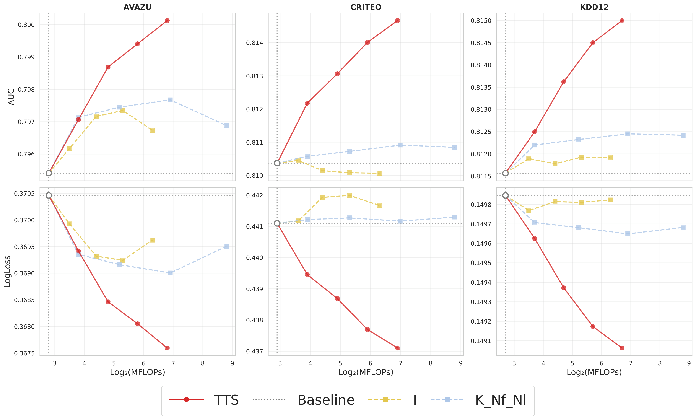
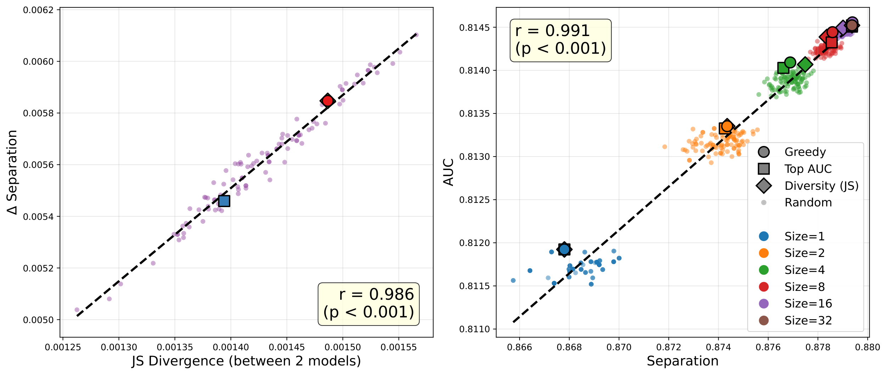
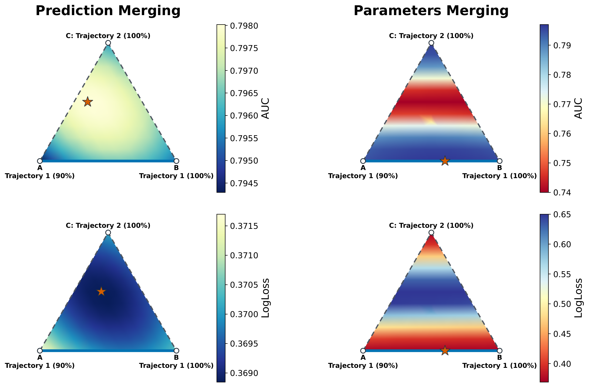

# TTS4CTR-TORS: Conditional Test-time Scaling Framework

This repository contains the public framework for the TORS journal extension:

- **Prediction averaging**: conditions, classic CTR baselines, and prediction-bank analysis.
- **Capacity and topology**: member selection, grouped capacity, and topology analysis.
- **Trajectory merging**: checkpoint averaging within runs and prediction merging across runs.
- **Perturbation analysis**: MC-Dropout and feature-perturbation prediction merging.

## Scope

| Area | Included | Excluded |
|---|---|---|
| Core backbone | Wukong, RankMixer, FinalMLP, FNN, FM, DeepFM, IPNN, DCN, DCNv2 | Proprietary production models |
| Extension analysis | Quality, capacity, checkpoint merging, perturbations | Industrial/private pipelines |
| Data | TensorFlow-based TFRecord converter and dependency-free reader (reader-only parser, no writer) | Raw or processed datasets |
| Outputs | User-selected output directory | Experiment artifacts |

## Findings from public benchmarks

Experiments on Avazu, Criteo, and KDD12 cover eight CTR backbones.

- Prediction merging generally improves single-model AUC and LogLoss. Gains arrive early and taper as member count grows; it often compares favorably with parameter scaling at similar plotted FLOPs.

  

- Diversity alone is not enough. On Avazu, Wukong+RankMixer improves over Wukong pairs, while Wukong+FinalMLP has greater prediction diversity but lower aggregate quality than Wukong pairs.

  

- Averaging checkpoints from independent initializations can damage predictions. Averaging checkpoints within each trajectory, then merging predictions across trajectories, retained the reported nine-snapshot ensemble quality using three rather than nine forward passes in all six tested dataset/backbone settings.

  

## Install

```bash
conda env create -f environment.yml
conda activate tts4ctr-tors
```

Or:

```bash
python -m venv .venv
source .venv/bin/activate
pip install -r requirements.txt
```

Set `CUDA_VISIBLE_DEVICES` as needed. The loader defaults to a dependency-free
TFRecord parser; TensorFlow is not required.

## Data preparation

The converters use TensorFlow's official TFRecord writer. You can also preconvert
data with your own pipeline. The bundled TFRecord parser is reader-only. Examples:

```bash
python data/prepare_criteo.py --input data/raw/criteo --output data/criteo/record
python data/prepare_avazu.py --input data/raw/avazu --output data/avazu/record
python data/prepare_kdd12.py --input data/raw/kdd12 --output data/kdd12/record
```

Check each converter's `--help` for exact split-name and column options. Optional
in-memory caches are written under `TTS4CTR_CACHE_DIR` (default: `outputs/cache`).

## Training and prediction export

```bash
python train.py avazu wukong \
  --feature 4500000 --field 24 \
  --data_dir data/avazu/record \
  --save_dir outputs/checkpoints/wukong-seed2001.pt \
  --seed 2001 --cuda -1

# Classic CTR baseline example
python train.py avazu dcnv2 \
  --feature 4500000 --field 24 --cross 3 \
  --data_dir data/avazu/record \
  --save_dir outputs/checkpoints/dcnv2-seed2001.pt \
  --seed 2001 --cuda -1

python train_group.py avazu wukong+rankmixer \
  --feature 4500000 --field 24 \
  --data_dir data/avazu/record \
  --save_dir outputs/checkpoints/w-r-seed2001.pt \
  --aux_branch_weight 0.03 \
  --skip_test --seed 2001

python test.py avazu wukong \
  --feature 4500000 --field 24 \
  --data_dir data/avazu/record \
  --save_dir outputs/checkpoints/wukong-seed2001.pt \
  --eval_splits validation test --save_logits
```

`--skip_test` keeps test data untouched while selecting checkpoints on validation.
Do not run test evaluation until the validation-selected configuration is frozen.

## Manifest format

Create one JSON manifest per prediction bank:

```json
{
  "name": "dataset-backbone-split",
  "labels_path": "outputs/labels/validation.npy",
  "members": [
    {"member": "seed2001", "path": "outputs/predictions/seed2001.npy"}
  ]
}
```

Probability arrays must be one-dimensional and aligned row-by-row with labels.
`tools/analyze_prediction_bank.py` can inventory existing banks and compute
topology, pooling, calibration, and selection diagnostics.

## Analysis tools

```bash
# Analyze saved prediction banks
python tools/analyze_prediction_bank.py --tasks manifest topology pooling stability calibration \
  --split validation --output-dir outputs/analysis/banks

# Select prediction members at several scales
python tools/select_prediction_members.py --bank-json outputs/manifests/wukong.json \
  --scales 2 4 8 16 --selection random --output outputs/analysis/member_selection.csv

# Compare branch and group capacity
python tools/analyze_group_capacity.py --manifest outputs/manifests/group.json \
  --group-size 4 --pooling logit --output outputs/analysis/group_capacity.csv

# Merge checkpoints within a trajectory and predictions across trajectories
python tools/merge_trajectories.py --dataset avazu --model wukong \
  --checkpoint-paths outputs/checkpoints/run1.pt outputs/checkpoints/run2.pt \
  --prediction-paths outputs/predictions/run1.npy outputs/predictions/run2.npy \
  --labels outputs/labels/test.npy --output outputs/analysis/trajectory_merge.json

# Compare parent and perturbed prediction merging
python tools/analyze_perturbation_merging.py --parent outputs/predictions/parent.npy \
  --members outputs/predictions/mc-*.npy --labels outputs/labels/test.npy \
  --output outputs/analysis/perturbation_merge.json
```

`merge_trajectories.py` also writes `<output>.soup.pt` when given multiple checkpoints.

## Validation

```bash
python -m pytest tests -q
```

Current checks cover exact AUC, probability/logit pooling identities, quality
decomposition, compatible state merging, and manifest round-trip behavior.
